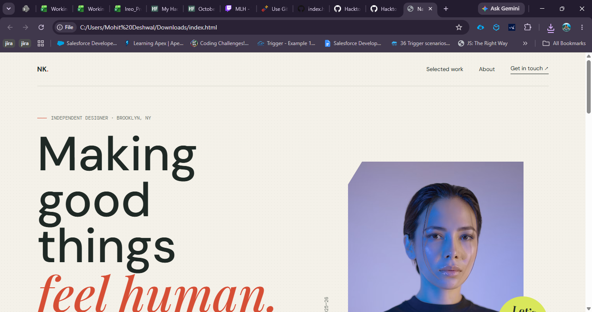

# Hacktoberfest-GitHub-Copilot-to-Build-a-Simple-Application

A responsive, single-page portfolio website built with HTML, CSS, and JavaScript. It features an introduction, selected projects, an about section, and a contact area.

## View the website

Open [`index.html`](index.html) in a web browser. No build tools or dependencies are required. The page loads its fonts and photography from external services, so an internet connection is needed for those assets.

## Features

- Responsive layout with mobile navigation
- Project showcase and about section
- Copy-email contact button
- Accessible page landmarks and reduced-motion support

## Screenshot

